# Neural Network Decision Boundary Visualizer


A multi-layer neural network built from scratch with **raw Python and NumPy matrix math**, plus a live split-screen simulator that shows how it learns. The left panel shows the decision boundary bending around the data; the right panel shows the network itself, with every neuron and weight updating in real time.

The point of the project: a single layer can only draw straight lines. This app shows how hidden layers take straight cuts and fold them into curves that wrap around a donut, a bullseye, or a pair of spirals.

<p align="center">
  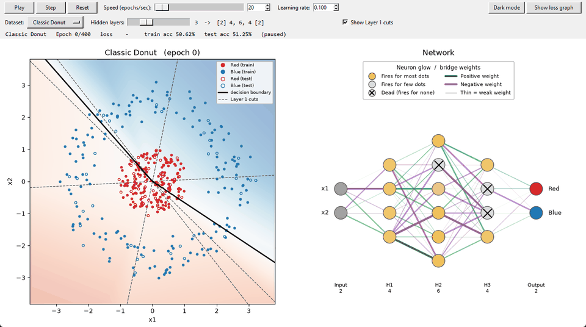<br>
  <em>Classic Donut, 3 hidden layers. The dashed lines are the first layer's straight cuts; the boundary is built from them.</em>
</p>

<p align="center">
  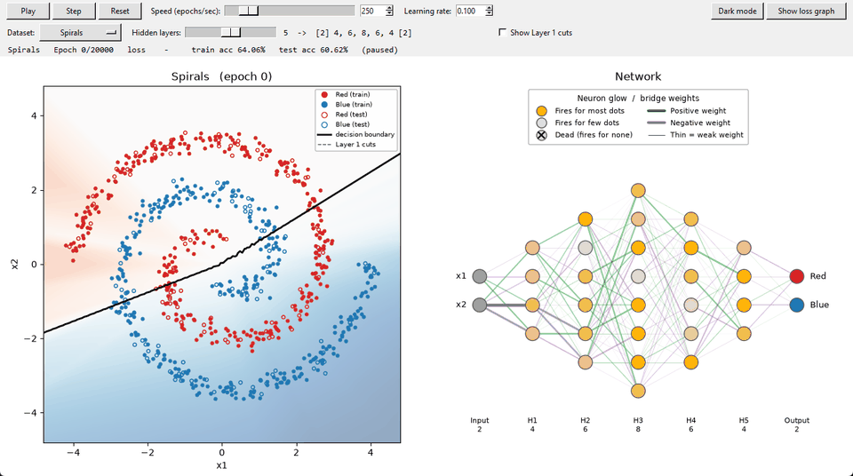<br>
  <em>Spirals, 5 hidden layers at 250 epochs/sec. Deeper layers bend those cuts into a shape that follows both arms.</em>
</p>

---

## Highlights

- **From scratch.** Forward pass, softmax, cross-entropy, backpropagation, and gradient descent are written by hand in NumPy. There are no ML libraries.
- **Adjustable diamond architecture.** A slider picks 1, 3, 5, 7, or 9 hidden layers that widen toward the middle and narrow back down.
- **A live view of the network.** Nodes glow by how often they fire, dead neurons are marked, and every weight is drawn with its strength and sign.
- **Five datasets of increasing difficulty**, from a clean donut to interleaved spirals.
- **Layer 1 cuts overlay.** It draws the first layer's straight lines on top of the curved boundary, so you can see the folding happen.
- **Verified math.** The backpropagation gradients were checked against numerical estimates (see [Verification](#verification)).

## The datasets

Every dataset is split evenly between the two classes. It is shuffled and split 80/20 into train and test sets using a fixed seed. Each dataset has its own epoch budget and default speed, so every run takes about **20 seconds** to watch.

The trained results below use the default network (3 hidden layers, learning rate 0.1).

<table>
  <tr>
    <th>Dataset</th><th>Before training</th><th>After training</th>
  </tr>
  <tr>
    <td><b>1. Classic Donut</b><br>400 dots<br><br>A red disk inside a blue ring with a clean gap. The default level.</td>
    <td>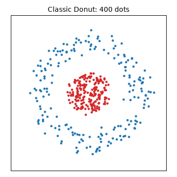</td>
    <td>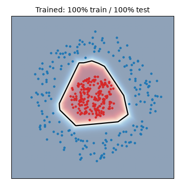</td>
  </tr>
  <tr>
    <td><b>2. Tight Donut</b><br>400 dots<br><br>The gap almost disappears and some dots overlap, so 100% is impossible.</td>
    <td>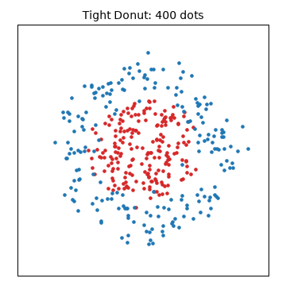</td>
    <td>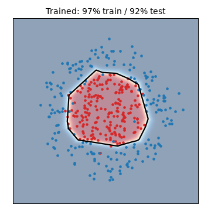</td>
  </tr>
  <tr>
    <td><b>3. Wobbly Donut</b><br>500 dots<br><br>Both classes follow a 5-petal flower shape, so the boundary has to bend in and out.</td>
    <td>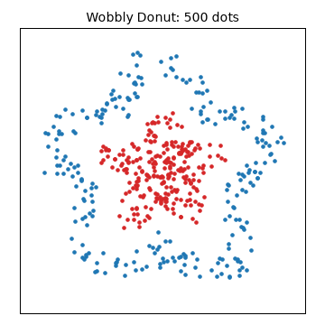</td>
    <td>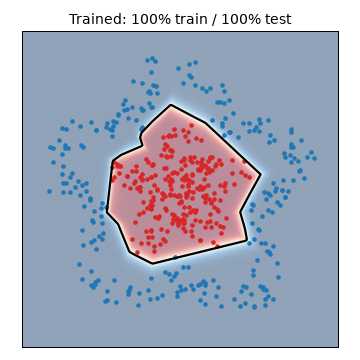</td>
  </tr>
  <tr>
    <td><b>4. Bullseye</b><br>600 dots<br><br>Red appears in two separate places (the center and an outer ring), so the network needs two boundaries.</td>
    <td>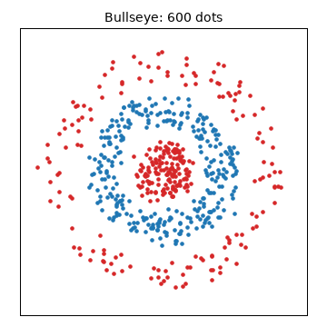</td>
    <td>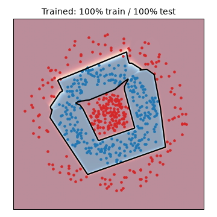</td>
  </tr>
  <tr>
    <td><b>5. Spirals</b><br>800 dots<br><br>Two interleaved spiral arms. The classic hardest toy problem.</td>
    <td>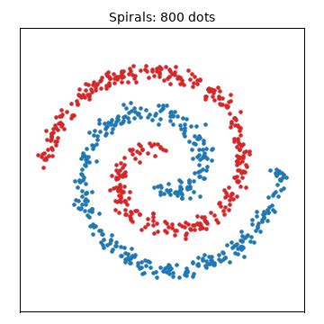</td>
    <td>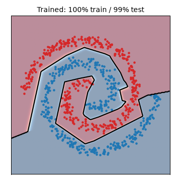</td>
  </tr>
</table>

## Architecture

The network always has **2 inputs** ($x_1, x_2$) and **2 outputs**: one "boss" per class. The hidden layers form a diamond that starts at 4 neurons, grows by 2 toward the middle, then shrinks back:

| Hidden layers | Full network |
|---|---|
| 1 | `[2] → 4 → [2]` |
| **3 (default)** | `[2] → 4, 6, 4 → [2]` |
| 5 | `[2] → 4, 6, 8, 6, 4 → [2]` |
| 7 | `[2] → 4, 6, 8, 10, 8, 6, 4 → [2]` |
| 9 | `[2] → 4, 6, 8, 10, 12, 10, 8, 6, 4 → [2]` |

- **Hidden layers use ReLU.** Each neuron outputs $\max(0, Z)$, which folds the space it receives.
- **The output layer uses softmax.** The two bosses (red specialist and blue specialist) output probabilities that always add up to 1, so they can never both claim the same dot. Labels are one-hot: red = $[1, 0]$, blue = $[0, 1]$.
- **Weights use He initialization**, random values with standard deviation $\sqrt{2 / n_{in}}$. Starting every weight at 0 would make all the neurons in a layer identical forever (the symmetry problem). Biases start at 0.

## How it works

Every epoch runs the same three-step cycle on all $N$ training dots at once, using one matrix multiplication per layer.

### 1. Forward pass (left → right)

The inputs are the activations of layer 0:

$$A_0 = X \quad (N \times 2)$$

For every layer $l$, compute the linear sum. It uses the **previous layer's activations** and **this layer's weights and bias**:

$$Z_l = A_{l-1} W_l + b_l$$

Hidden layers ($l = 1 \dots L-1$) apply ReLU:

$$A_l = \text{ReLU}(Z_l) = \max(0, Z_l)$$

Repeat until you reach the final layer $L$, then apply **softmax** to get the bosses' predictions:

$$\hat{Y} = A_L = \text{softmax}(Z_L), \qquad \hat{y}_k = \frac{e^{z_k}}{e^{z_1} + e^{z_2}}$$

The loss is categorical cross-entropy, averaged over all $N$ dots:

$$\mathcal{L} = -\frac{1}{N} \sum_{i=1}^{N} \sum_{k=1}^{2} Y_{ik} \log \hat{Y}_{ik}$$

### 2. Backward pass (right → left)

Find the error for each boss neuron. Softmax and cross-entropy simplify to:

$$\frac{\partial \mathcal{L}}{\partial Z_L} = A_L - Y = \hat{Y} - Y$$

Then loop backward from layer $L$ down to layer 1:

**a) Weight gradients** (error × the previous layer's activations)

$$dW_l = \frac{1}{N} A_{l-1}^\top \frac{\partial \mathcal{L}}{\partial Z_l}$$

**b) Bias gradients** (error × 1, summed over the $N$ dots)

$$db_l = \frac{1}{N} \sum_{i=1}^{N} \left(\frac{\partial \mathcal{L}}{\partial Z_l}\right)_i$$

**c) Pass the blame back to layer $l-1$**

Send the error back through the same weights it came forward through. This is the **unfiltered blame**:

$$\frac{\partial \mathcal{L}}{\partial A_{l-1}} = \frac{\partial \mathcal{L}}{\partial Z_l} \, W_l^\top$$

Then filter it through ReLU's switch, an element-by-element multiplication ($\odot$) with the mask from the forward pass. This is the **filtered blame**:

$$\frac{\partial \mathcal{L}}{\partial Z_{l-1}} = \frac{\partial \mathcal{L}}{\partial A_{l-1}} \odot (Z_{l-1} > 0)$$

- Where the neuron was **on** ($Z > 0$), the blame passes through.
- Where it was **off** ($Z \le 0$), the blame gets wiped out.

### 3. Adjust the knobs

Only after the **entire** backward pass, update every layer with learning rate $\alpha$:

$$W_l \leftarrow W_l - \alpha \, dW_l \qquad b_l \leftarrow b_l - \alpha \, db_l$$

Updating a layer before its blame has been passed back would send the error through weights that have already changed, which gives wrong gradients.

### 4. Repeat with the updated knobs

$$\text{Forward pass} \longrightarrow \text{Backward pass} \longrightarrow \text{Adjust knobs} \longrightarrow \text{Forward pass (updated)} \longrightarrow \cdots$$

The cycle repeats until the dataset's epoch budget runs out, or until **early stopping** ends it: if the loss hasn't improved by 0.0001 for a quarter of the budget, training stops.

## Results

Default network (3 hidden layers, learning rate 0.1), trained for each dataset's epoch budget:

| Dataset | Epoch budget | Default speed | Train accuracy | Test accuracy |
|---|---|---|---|---|
| Classic Donut | 400 | 20 epochs/sec | 100.0% | 100.0% |
| Tight Donut | 1,500 | 75 epochs/sec | 96.6% | 92.5% |
| Wobbly Donut | 800 | 40 epochs/sec | 99.8% | 100.0% |
| Bullseye | 5,000 | 250 epochs/sec | 99.6% | 100.0% |
| Spirals | 20,000 | 1,000 epochs/sec | 100.0% | 99.4% |

Each epoch budget is about twice the point where training accuracy stops changing. The boundary forms in the first half of a run, and the network becomes more confident in the second half.

## Experiments and observations

### More layers isn't automatically better

Test accuracy for every dataset at every depth (learning rate 0.1, same seed, same budgets):

| Dataset | 1 hidden | 3 hidden | 5 hidden | 7 hidden | 9 hidden |
|---|---|---|---|---|---|
| Classic Donut | 100% | 100% | 100% | 100% | 100% |
| Tight Donut | 94% | 92% | 94% | 91% | 92% |
| Wobbly Donut | 96% | 100% | 92% | 99% | 100% |
| Bullseye | 70% | 100% | 99% | 100% | 76% |
| Spirals | 74% | 99% | 100% | 78% | 48% |

<p align="center">
  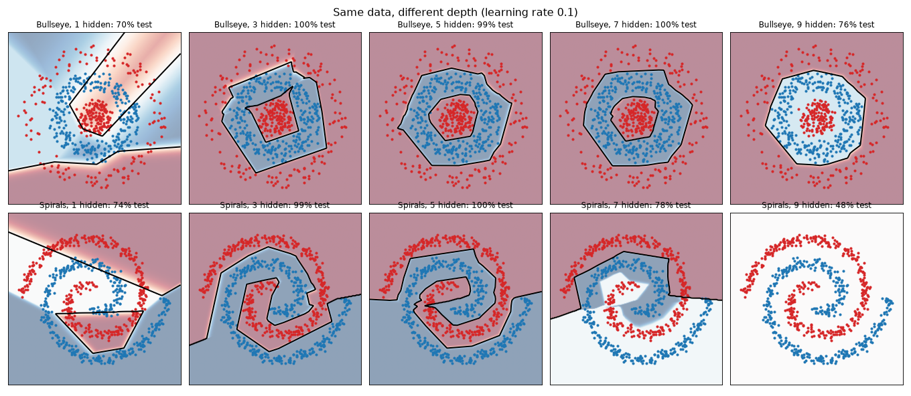
</p>

- **One hidden layer is enough for the donuts.** Four straight cuts can enclose a single blob, and the Classic Donut is solved at every depth.
- **One hidden layer fails when the shape needs more than one enclosure.** The Bullseye needs two boundaries and the Spirals need a winding one. With only 4 straight lines, the network gets stuck at 70–74%.
- **The Tight Donut's limit is the data, not the model.** Every depth lands at 91–94% test accuracy because the classes overlap. Deeper networks fit the training dots slightly better (up to 98%) without improving on the test dots, which is early overfitting.
- **Depth past the sweet spot hurts.** 3–5 hidden layers solve everything. At 7 layers the Spirals get stuck at 78%, and at 9 layers the Bullseye and Spirals collapse.

### A lower learning rate rescues deep networks

The 9-layer network collapses on the Spirals at learning rate 0.1. It ends at 48% test accuracy (a coin flip), with **26 of its 68 neurons dead**. The same network at learning rate 0.03 reaches **98%**:

<p align="center">
  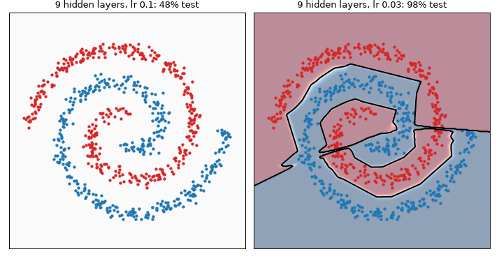
</p>

| 9 hidden layers | lr 0.1 | lr 0.03 |
|---|---|---|
| Bullseye | 76% | 99% |
| Spirals | 48% | 98% |

The trade-off is that the budgets were measured at learning rate 0.1, so shallow networks at 0.03 often run out of epochs before they finish. For example, the Classic Donut with 3 layers reaches only 85%.

### Dead neurons pile up with depth

A ReLU neuron that outputs 0 for **every** dot gets zero gradient, because the mask $(Z > 0)$ wipes out all of its blame. It can never recover. The live view marks these neurons with ×:

<p align="center">
  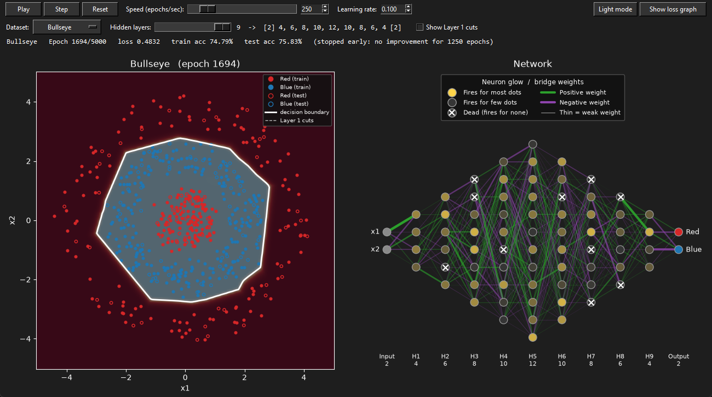<br>
  <em>Bullseye, 9 hidden layers, learning rate 0.1: many neurons are dead, and the network has lost the red center.</em>
</p>

At learning rate 0.1, the 1-layer network ends with no dead neurons on any dataset. The 9-layer network ends with 8–26 dead neurons, depending on the dataset.

### Training isn't smooth

The Spirals with 3 hidden layers reach 100%, but the path there includes sharp loss spikes, where single updates overshoot. That's why early stopping waits a quarter of the budget instead of a fixed number of epochs: a shorter patience quit during these spikes at 73–90% accuracy.

<p align="center">
  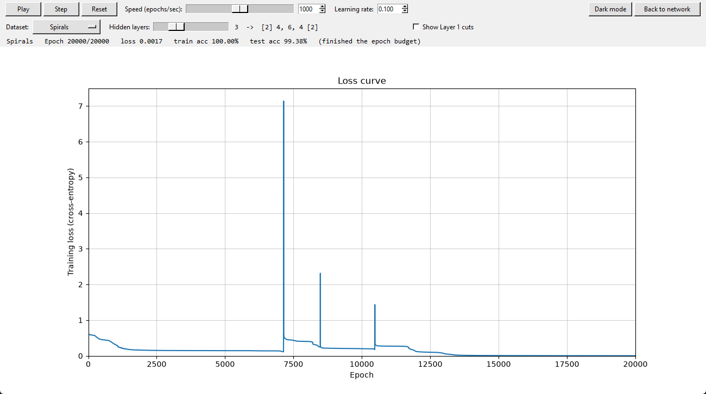
</p>

### The Layer 1 cuts show the folding

Every first-layer neuron computes $w_1 x_1 + w_2 x_2 + b$, a straight line, which is exactly a single logistic regression. With **Show Layer 1 cuts** on, those lines are drawn on the plot:

- With **1 hidden layer**, the final boundary is made directly from pieces of those 4 lines, so it looks like a polygon.
- With **more hidden layers**, later layers combine and fold the cuts, so the boundary can bend away from the original straight lines (see the Spirals GIF).

## Verification

The backward pass was checked with a **numerical gradient check**. Each weight is nudged by $\varepsilon = 10^{-6}$ in both directions, and the slope

$$\frac{\mathcal{L}(w + \varepsilon) - \mathcal{L}(w - \varepsilon)}{2\varepsilon}$$

is compared against the gradient from backpropagation. After a few training steps, every layer matches to within about $10^{-11}$.

One subtle edge case: right after initialization, some neurons have $Z$ **exactly** 0. Every neuron feeding them is off and their bias is still 0, so they sit on ReLU's sharp corner, where no slope exists. The numerical check can't measure them there. These are the only mismatches, and they disappear as the biases move away from 0. Very deep networks keep a few exact zeros longer.

## Screenshots

<p align="center">
  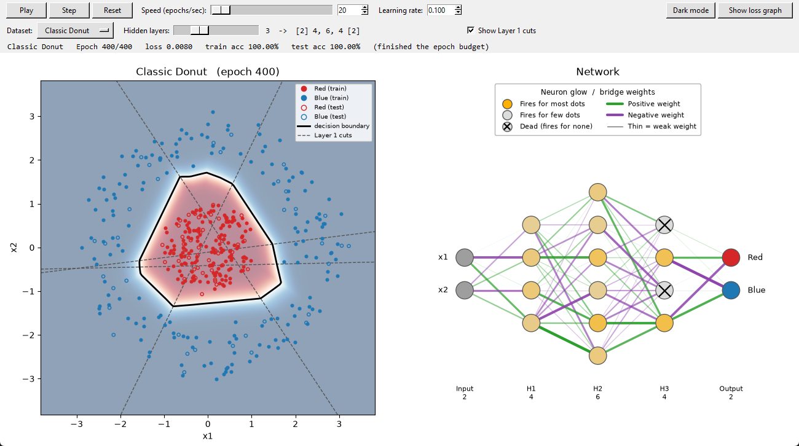<br>
  <em>Classic Donut at the end of training: the boundary is a polygon built from the 4 dashed Layer 1 cuts.</em>
</p>

<p align="center">
  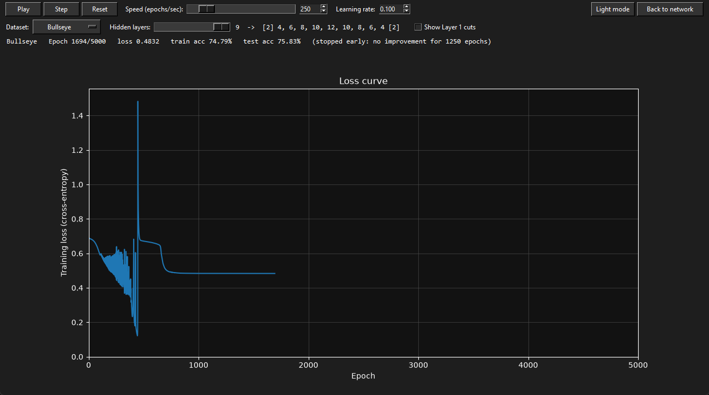<br>
  <em>The loss graph screen in dark mode.</em>
</p>

## Getting started

**Requirements:** Python 3.10+

```bash
git clone https://github.com/aydsman/Neural-Network-Decision-Boundary-Visualizer.git
cd Neural-Network-Decision-Boundary-Visualizer
python -m pip install -r requirements.txt
```

**Launch the live simulator:**

```bash
python visualize.py
```

**Train once from the command line.** This prints the loss and accuracy, then shows a static plot:

```bash
python main.py
```

### Controls

| Control | Action |
|---|---|
| **Play / Pause** | Start or stop training |
| **Step** | Run exactly one epoch |
| **Reset** | Restart from the same initial weights, so runs are comparable |
| **Speed** | Epochs per second (1–2,000); set to each dataset's 20-second default when you pick a dataset |
| **Learning rate** | Step size for gradient descent; it can be changed during training |
| **Dataset** | Choose one of the five datasets (resets training) |
| **Hidden layers** | 1, 3, 5, 7, or 9 diamond-shaped hidden layers (resets training) |
| **Show Layer 1 cuts** | Draw the first hidden layer's straight lines on the plot |
| **Show loss graph** | Switch to the live loss curve and back; training continues on either screen |
| **Dark mode** | Toggle between light and dark themes |

The status bar shows the epoch out of the budget, the loss, train and test accuracy, and why training ended: the budget ran out, it stopped early, or it diverged.

**Reading the network panel:**

- **Node glow** shows the percentage of dots that switch a neuron on. Bright means most dots, dim means few, and × means none (dead).
- **Line thickness** shows how strong a weight is.
- **Line color** shows the weight's sign: green for positive, purple for negative.

## Configuration

Settings are constants at the top of [`main.py`](main.py):

| Constant | Default | Description |
|---|---|---|
| `SEED` | `42` | Random seed for the data, the split, and the initial weights |
| `TRAIN_FRACTION` | `0.8` | Fraction of dots used for training |
| `LEARNING_RATE` | `0.1` | Default gradient descent step size |
| `DEFAULT_DATASET` | `"Classic Donut"` | Dataset loaded on startup |
| `DEFAULT_HIDDEN_LAYERS` | `3` | Hidden layers on startup |
| `TARGET_SECONDS` | `20` | Default speeds are set so each budget finishes in about this long |
| `EARLY_STOP_PATIENCE_FRACTION` | `0.25` | Stop if the loss hasn't improved for this fraction of the budget |
| `EARLY_STOP_MIN_DELTA` | `1e-4` | Smallest change that counts as an improvement |
| `DATASETS` | | Each dataset's generator, dot count, and epoch budget |

## Project structure

```
Neural-Network-Decision-Boundary-Visualizer/
├── main.py           # Datasets, network math, training, evaluation, static plot
├── visualize.py      # Tkinter split-screen simulator
├── requirements.txt
└── assets/           # GIFs, screenshots, and figures used in this README
```

**`main.py` functions**

| Function | Purpose |
|---|---|
| `classic_donut`, `tight_donut`, `wobbly_donut`, `bullseye`, `spirals` | Generate each dataset |
| `split`, `one_hot` | Shuffle and split 80/20; turn labels into one-hot pairs |
| `diamond`, `layer_sizes` | Build the architecture from the number of hidden layers |
| `init_params` | He initialization |
| `relu`, `softmax`, `cross_entropy` | Activations and loss |
| `forward`, `backward`, `train_step` | The three-step training cycle |
| `train`, `EarlyStopping` | The full training loop with early stopping |
| `predict`, `accuracy`, `activation_rates` | Evaluation, plus the data behind the node glow |

## Possible extensions

- Click a dot to trace its exact path through the network
- Leaky ReLU, to prevent dead neurons
- Mini-batch or stochastic gradient descent, and optimizers like momentum and Adam
- L2 regularization or dropout for the overlapping Tight Donut
- Adjustable layer widths, not just depth
- More than two classes (softmax already supports it)
